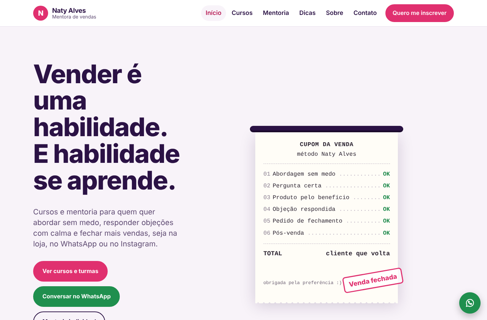
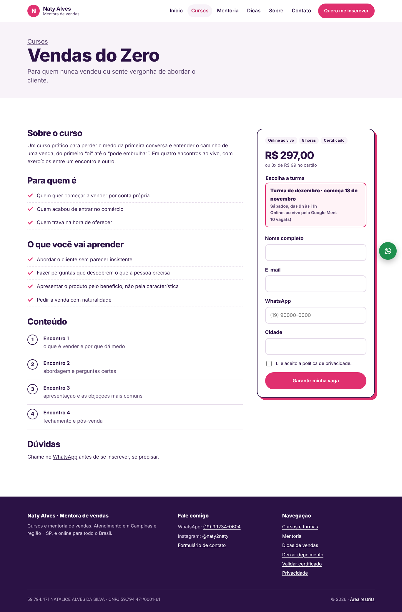
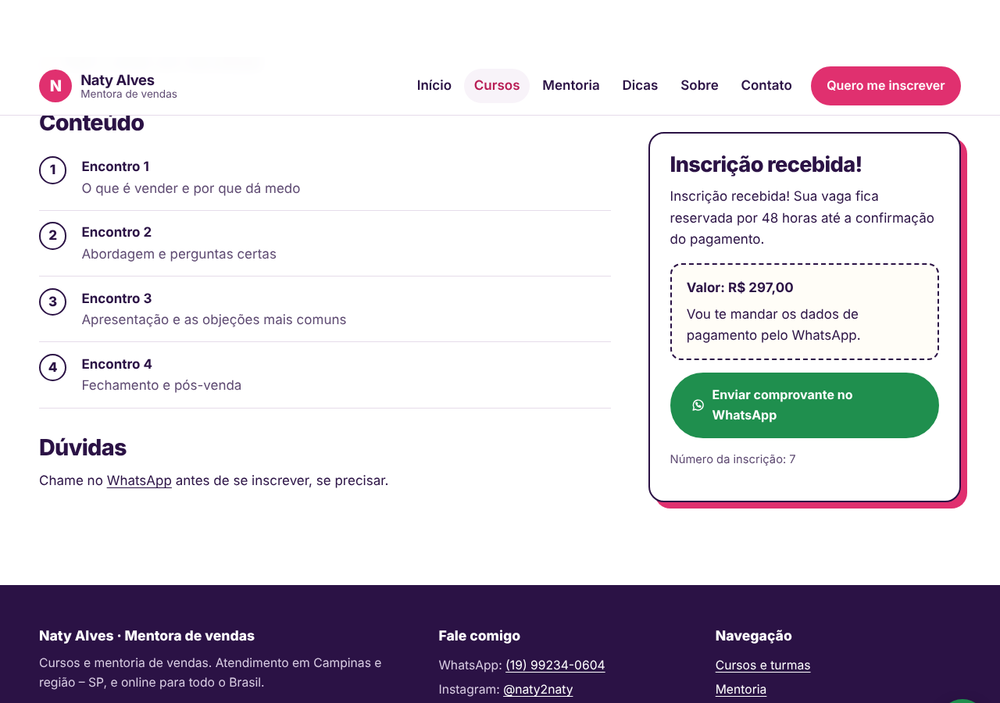
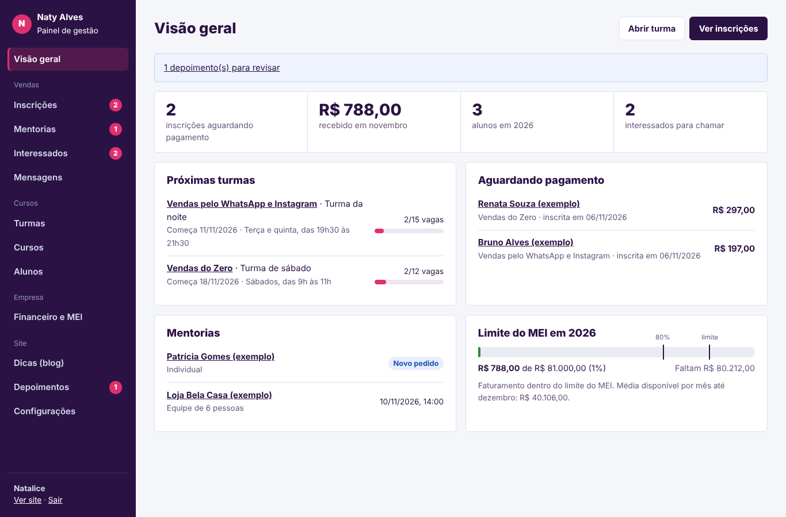
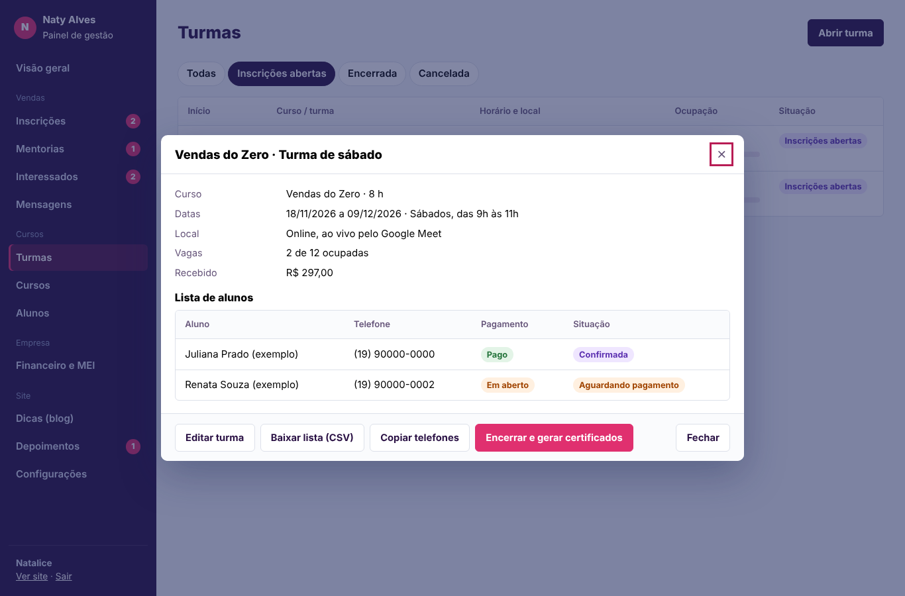

# Naty Alves · Mentoria e Cursos de Vendas

Site e sistema de gestão para **Natalice Alves da Silva (Naty)**, mentora e instrutora de vendas:
divulgação dos cursos, inscrição em turmas com pagamento por Pix, pedidos de mentoria, blog de dicas,
certificado com validação online e controle financeiro do MEI.

Projeto de extensão do curso de **Análise e Desenvolvimento de Sistemas (UNIP)**, com front-end,
back-end e banco de dados.



## O que o sistema faz

**Site público**
- Página inicial com chamada forte, públicos, cursos em destaque, mentoria, dicas, depoimentos, FAQ e captação de contatos
- Catálogo de cursos e página de cada curso: conteúdo, para quem é, o que aprende, turmas abertas com **vagas restantes**
- **Inscrição online** na turma, com bloqueio de turma lotada e de inscrição duplicada; depois da inscrição o aluno
  vê a chave Pix e um botão para mandar o comprovante pelo WhatsApp já com a mensagem pronta
- Pedido de mentoria individual ou para equipes
- **Palavra do dia e dica do dia** na página inicial, que mudam sozinhas a cada dia
- Página **Treino de vendas**: 40 palavras para ampliar o repertório, checklist de atendimento interativo com nota,
  preço e valor, e "da resposta à oportunidade"
- Capas ilustradas para os cursos (substituíveis por foto no painel)
- Blog de dicas de vendas (bom para o Google e para compartilhar no Instagram)
- **Validação pública de certificado** pelo código impresso
- Depoimentos com moderação, contato, política de privacidade (LGPD), botão flutuante de WhatsApp, responsivo e acessível

**Painel administrativo**
- **Visão geral**: inscrições aguardando pagamento, ocupação das próximas turmas, mentorias, interessados, limite do MEI
- **Inscrições**: filtro por situação e curso; registrar pagamento (confirma a vaga e lança a receita); mensagens prontas
  de cobrança e confirmação no WhatsApp
- **Turmas**: datas, horário, local, link da aula, vagas e preço especial; lista de alunos em CSV; copiar telefones
  para lista de transmissão; **encerrar turma e gerar certificados em PDF** (A4 paisagem, com código de validação)
- **Cursos**: conteúdo completo, capa, preço ou "sob consulta", destaque na página inicial
- **Alunos**: histórico de cursos e total pago; exclusão a pedido (LGPD)
- **Mentorias**: agendamento, valor, anotações, lançamento do pagamento
- **Interessados**: contatos que pediram dicas, marcação de quem já foi chamado, exportação
- **Financeiro e MEI**: receitas e despesas, gráfico mensal, CSV, medidor do limite do MEI (proporcional no ano de abertura) e DAS mês a mês
- **Dicas, depoimentos, mensagens e configurações** (textos, contatos, chave Pix, dados do MEI, troca de senha, histórico de atividades)

## Tecnologias

| Camada | Escolha |
|---|---|
| Back-end | Python 3.12 · FastAPI (API REST documentada em `/docs`) |
| Banco | SQLite com SQLAlchemy 2.0 (troca para PostgreSQL pela `DATABASE_URL`) · 15 tabelas |
| Autenticação | JWT + bcrypt, limite de tentativas |
| Front-end | HTML, CSS e JavaScript em módulos, sem etapa de build |
| Testes | pytest (15 testes da API) + testes de ponta a ponta no navegador durante o desenvolvimento |
| Implantação | Docker / docker-compose |

## Como rodar

```bash
cd backend
python -m venv .venv && source .venv/bin/activate     # Windows: .venv\Scripts\activate
pip install -r requirements.txt
python -m app.seed --demo        # opcional: turmas, alunos e lançamentos fictícios para demonstração
uvicorn app.main:app --reload
```

- Site: http://localhost:8000 · Painel: http://localhost:8000/admin · API: http://localhost:8000/docs
- Primeiro acesso: `admin@natyalves.com.br` / `Trocar@123` (troque em Configurações)
- Testes: `cd backend && pytest -q`
- Docker: `cp .env.example .env`, preencha `SECRET_KEY` e a senha, `docker compose up -d`

> Sem `--demo`, o sistema começa com os 4 cursos (preço "sob consulta") e 3 dicas em rascunho para ela revisar.
> `--demo` cria dados **fictícios** marcados como "(exemplo)": não use no site de produção.

## Estrutura

```
backend/app/
  main.py  models.py  schemas.py  security.py  uploads.py  site_settings.py  seed.py
  routers/  public · auth · courses · academy · content · finance · dashboard
frontend/
  *.html                12 páginas do site
  admin/                login e painel (SPA com rotas por hash)
  assets/css · js       estilos, site.js e módulos do painel
docs/                   modelo de dados, manual, publicação, relatório de extensão, telas
```

## Documentação
[Modelo de dados](docs/MODELO_DE_DADOS.md) · [Manual do painel](docs/MANUAL_DO_PAINEL.md) ·
[Publicação](docs/DEPLOY.md) · [Relatório de extensão](docs/RELATORIO_EXTENSAO.md)

## Telas

| Página do curso | Inscrição concluída |
|---|---|
|  |  |
| **Painel** | **Turma e certificados** |
|  |  |

---
Desenvolvido por Erik Junior · [Codex Web](https://codexweb.com.br)
