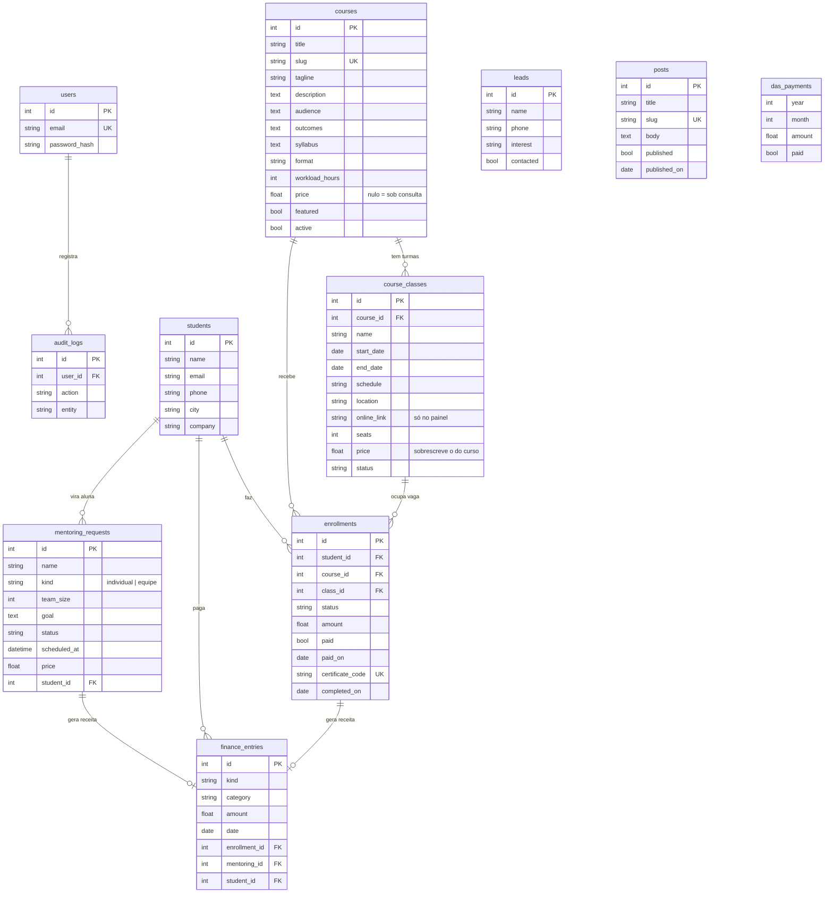

# Modelo de dados

15 tabelas, definidas em `backend/app/models.py` e criadas automaticamente na primeira execução.

Também existem `settings` (configurações em JSON), `testimonials` e `contact_messages`.

## Regras de negócio

| Regra | Onde |
|---|---|
| Vagas = `seats` − inscrições não canceladas da turma; turma lotada recusa inscrição (409) | `public.enroll`, `courses.update_class` |
| Curso com turmas abertas exige escolher a turma; turma encerrada não aceita inscrição | `public.enroll` |
| Mesmo e-mail não se inscreve duas vezes na mesma turma | `public.enroll` |
| Aluno é identificado pelo e-mail; inscrições novas reaproveitam o cadastro | `public.enroll` |
| Preço da inscrição = preço da turma, se houver; senão, o do curso | `public.enroll` |
| Registrar pagamento confirma a inscrição e cria **uma** receita vinculada | `academy.register_payment` |
| Encerrar turma conclui as inscrições confirmadas e gera códigos únicos de certificado | `academy.complete_class` |
| Certificado só valida para inscrição concluída | `public.verify_certificate` |
| Mentoria agendada vira aluna automaticamente; cada mentoria gera no máximo uma receita | `academy.update_mentoring`, `bill_mentoring` |
| Curso/turma com inscrições não pode ser excluído (desative ou cancele) | `courses` |
| Limite do MEI proporcional no ano de abertura; alertas em 80% e 100% | `finance.mei_status` |
| Chave Pix nunca sai na rota pública de configurações; só aparece após a inscrição | `site_settings.get_public` |
